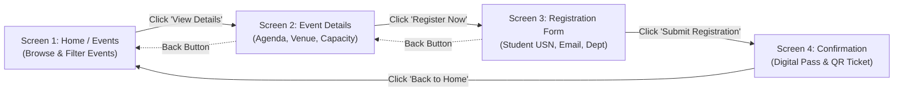
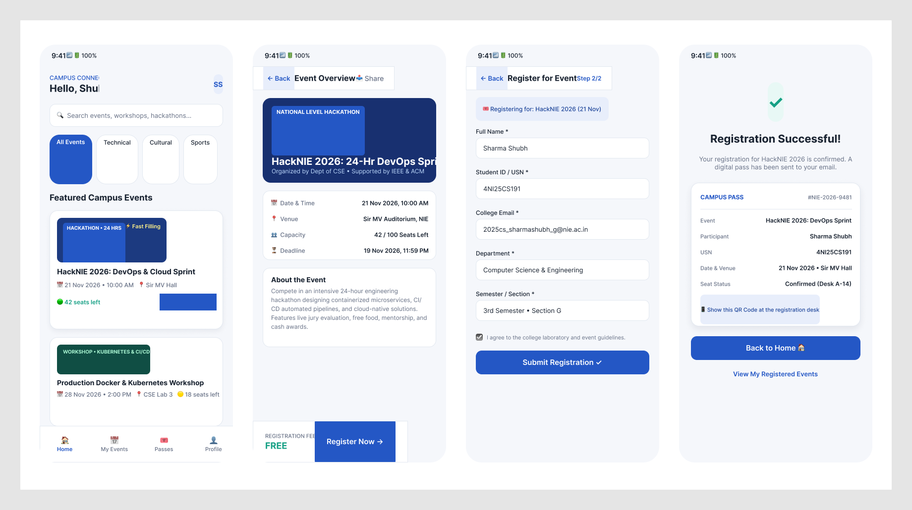
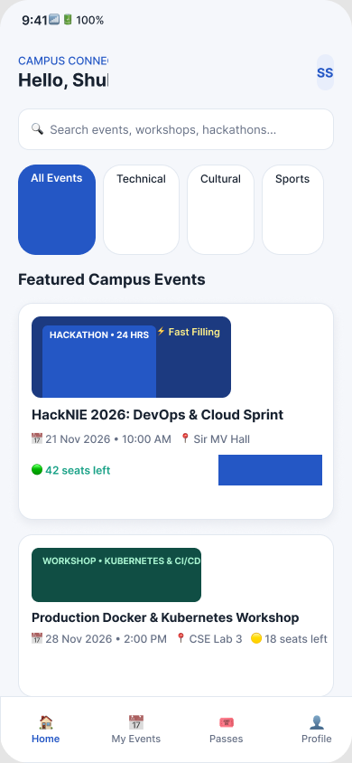
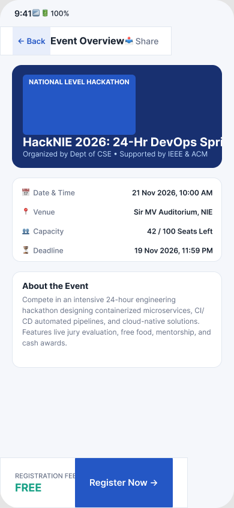
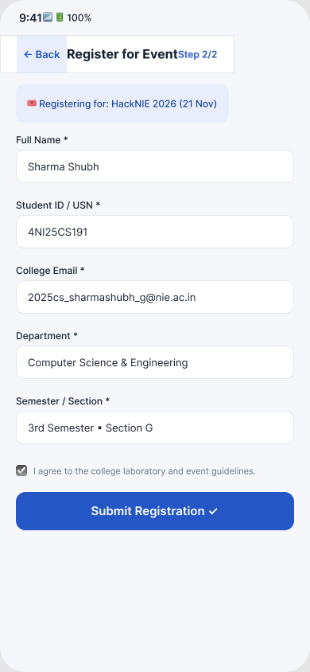
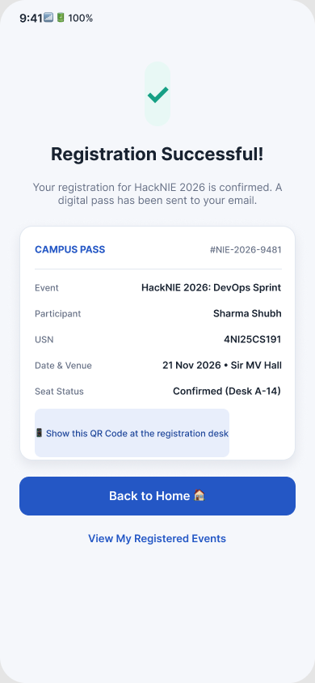
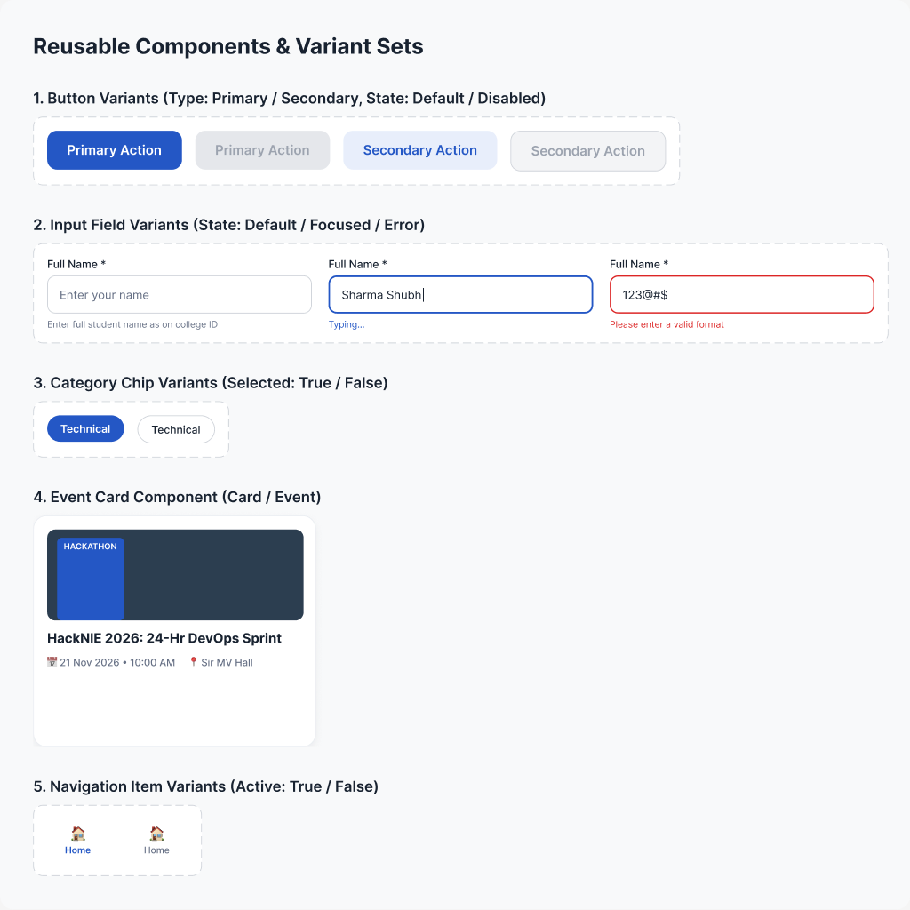
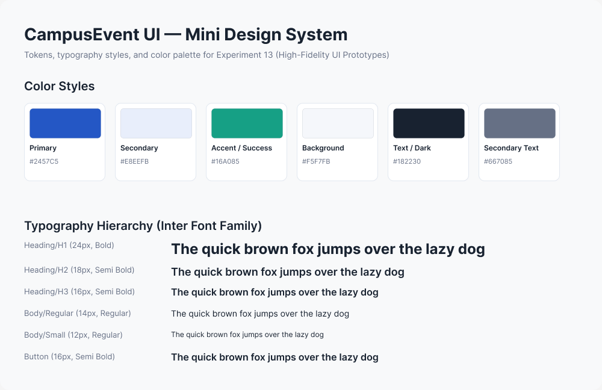

# Experiment 13: Design High-Fidelity UI Prototypes and Reusable Components Using Figma

- **Student Name**: Sharma Shubh
- **USN**: 4NI25CS191
- **Semester / Section**: 3rd Sem, Sec-G
- **Course**: Collaborative Development and DevOps (1BCS303) / UI/UX Design Lab
- **Institution**: The National Institute of Engineering, Mysuru
- **Figma File URL**: [Figma Design & Prototype Workspace](https://www.figma.com/design/8hmZaqz3nlZDO9j7b6zANH)

---

## 1. Aim & Objectives

### Aim
To design a high-fidelity user interface prototype for a selected application (**CampusConnect — Campus Event Registration App**) using Figma, create reusable UI components with consistent design tokens and variants, apply Auto Layout for responsive behavior, and connect screens into an interactive, clickable prototype.

### Learning Outcomes
1. Set up a Figma design project with organized pages (`01 - Screens`, `02 - Components`, `03 - Design System`).
2. Construct a foundational design system encompassing color styles, typography ramp (Inter), and spacing tokens.
3. Build reusable UI components with component variants (`Type=Primary/Secondary`, `State=Default/Disabled/Focused/Error`).
4. Implement Auto Layout (padding, direction, resizing constraints: Fixed, Hug, Fill).
5. Design 4 high-fidelity mobile frames (iPhone 15, 390 × 844 px) representing an end-to-end user journey.
6. Connect screens in Figma Prototype mode with `On click -> Navigate to` and `Smart Animate` transitions.
7. Export production-ready assets and build an interactive standalone HTML/CSS web simulation.

---

## 2. Files in Repository

- `README.md`: Complete lab record, design documentation, prototype specifications, observations, and viva-voce answers.
- `index.html`: Standalone, zero-dependency interactive HTML5 prototype replicating the mobile user flow with an iPhone frame simulator.
- `styles.css`: Complete CSS design token implementation adhering strictly to the Figma color palette and typography ramp.
- `app.js`: Prototype interaction controller handling screen navigation, form validation, and active tab transitions.
- `assets/screenshots/`: High-resolution PNG exports generated directly from the Figma canvas via the Figma API:
  - `00_all_screens_user_flow.png`: Comprehensive side-by-side view of all four high-fidelity screens.
  - `01_home_screen.png`: Screen 1 — Home / Event Feed.
  - `02_event_details_screen.png`: Screen 2 — Event Details & Overview.
  - `03_registration_screen.png`: Screen 3 — Registration Form.
  - `04_confirmation_screen.png`: Screen 4 — Confirmation & Digital Event Pass.
  - `05_components_library.png`: Components Showcase (Buttons, Input Fields, Event Cards, Navigation, Chips).
  - `06_design_system.png`: Mini Design System (Color Swatches, Hex Tokens, and Typography Hierarchy).

---

## 3. Concepts & Theory in Brief

| Term | Meaning |
| :--- | :--- |
| **Low-Fidelity Wireframe** | Skeletal outline showing page structure, layout, and control placement without detailed styling or final content. |
| **High-Fidelity Prototype** | A realistic, polished representation of the final app with final colors, typography, real copy, elevation, and interactive flows. |
| **Component** | A master reusable design element (`ComponentNode`). Modifying the master component propagates updates to all its instances automatically. |
| **Instance** | A linked instance copy of a master component placed inside screens, supporting localized text and state overrides. |
| **Variant** | Grouped variations of a single component combined into a `ComponentSetNode` (e.g., Primary vs. Secondary, Default vs. Disabled). |
| **Auto Layout** | Figma's dynamic flexbox layout engine that arranges and spaces child items automatically when content changes or frames resize. |
| **Prototype** | A clickable simulation of the application created by wiring interactive triggers, actions, and animated transitions between frames. |
| **Smart Animate** | An interpolation engine that tracks matching layers across frames and animates position, scale, and opacity smoothly. |

---

## 4. Mini Design System Specifications

### 4.1 Color Styles & Tokens

The application employs a 60-30-10 color distribution strategy built around accessibility and visual clarity:

| Style Name | Hex Code | RGB (0–1 Figma Scale) | Intended Role & Semantic Usage |
| :--- | :--- | :--- | :--- |
| **Primary** | `#2457C5` | `(0.141, 0.341, 0.773)` | Brand primary, action buttons, active navigation states, key hyperlinks. |
| **Secondary / Tint** | `#E8EEFB` | `(0.910, 0.933, 0.984)` | Subtle containers, badges, secondary button surfaces, tag backgrounds. |
| **Accent / Success** | `#16A085` | `(0.086, 0.627, 0.522)` | Success states, seat availability indicators, confirmed status badges. |
| **Background** | `#F5F7FB` | `(0.961, 0.969, 0.984)` | Screen viewport background canvas ensuring high legibility. |
| **Text / Dark** | `#182230` | `(0.094, 0.133, 0.188)` | Primary headings, form labels, and high-contrast readable copy. |
| **Secondary Text** | `#667085` | `(0.400, 0.439, 0.522)` | Subtitles, event metadata, date/time chips, and form input hints. |
| **Card Surface** | `#FFFFFF` | `(1.000, 1.000, 1.000)` | Elevated surfaces for event cards, form fields, and modal containers. |
| **Border** | `#D1D5DB` | `(0.820, 0.835, 0.859)` | Subtle outlines for input fields, inactive chips, and card dividers. |
| **Alert / Error** | `#DC2626` | `(0.863, 0.149, 0.149)` | Error alerts, required validation warnings, and destructive actions. |

### 4.2 Typography Hierarchy (Inter Type Ramp)

| Style Name | Font Family | Weight | Size | Line Height | Usage |
| :--- | :--- | :--- | :--- | :--- | :--- |
| **Heading / H1** | Inter | Bold (700) | 24 px | 32 px | Screen titles, greeting banners, modal confirmations. |
| **Heading / H2** | Inter | Semi Bold (600) | 18 px | 26 px | Section headings, event card titles, hero headers. |
| **Heading / H3** | Inter | Semi Bold (600) | 16 px | 24 px | Subsection labels, card titles, form category titles. |
| **Body / Regular**| Inter | Regular (400) | 14 px | 20 px | Body copy, event descriptions, input field values. |
| **Body / Small**  | Inter | Regular (400) | 12 px | 16 px | Metadata, captions, secondary labels, helper hints. |
| **Button Text**   | Inter | Semi Bold (600) | 16 px | 22 px | CTA buttons, pill filters, primary action triggers. |

### 4.3 Spacing & Auto Layout Grid
- **Base Grid**: 8 pt grid system (4 px, 8 px, 12 px, 16 px, 20 px, 24 px, 32 px).
- **Corner Radii**:
  - Screen containers: `32 px` (mobile viewport)
  - Event Cards & Modals: `16 px`
  - Action Buttons & Inputs: `12 px`
  - Pills & Badges: `20 px` (fully rounded pills)
- **Drop Shadows**: `offset: (0, 4), blur: 12, opacity: 6%` for cards; `offset: (0, 6), blur: 16, opacity: 8%` for tickets.

---

## 5. Reusable UI Components & Variants

All components are authored on the `02 - Components` canvas with Auto Layout and component properties:

```
02 - Components Canvas
├── 1. Button (Component Set)
│   ├── Type=Primary, State=Default
│   ├── Type=Primary, State=Disabled
│   ├── Type=Secondary, State=Default
│   └── Type=Secondary, State=Disabled
├── 2. Field / Text Input (Component Set)
│   ├── State=Default
│   ├── State=Focused
│   └── State=Error
├── 3. Chip / Filter (Component Set)
│   ├── Selected=True
│   └── Selected=False
├── 4. Card / Event (Master Component)
│   └── Banner + Category Tag + Event Title + Meta Row + Seat Badge + CTA
└── 5. Navigation / Item (Component Set)
    ├── Active=True
    └── Active=False
```

### Component Breakdown
1. **Button Component Set (`Type`, `State`)**:
   - `Primary / Default`: Fill `#2457C5`, Text White, Padding (24px horizontal, 14px vertical), Radius 12px.
   - `Primary / Disabled`: Fill `#E5E7EB`, Text `#9CA3AF`, Pointer-events inactive.
   - `Secondary / Default`: Fill `#E8EEFB`, Text `#2457C5`, Radius 12px.
   - `Secondary / Disabled`: Fill `#F3F4F6`, Text `#9CA3AF`, Border `#D1D5DB`.
2. **Field / Text Input Component Set (`State`)**:
   - `Default`: 1px stroke `#D1D5DB`, background `#FFFFFF`, muted placeholder text.
   - `Focused`: 2px stroke `#2457C5`, active cursor indicator, dark typed value.
   - `Error`: 1.5px stroke `#DC2626`, red alert helper text underneath.
3. **Card / Event Master Component**:
   - Auto Layout vertical container (padding 14px, radius 16px, background `#FFFFFF`).
   - Integrated event banner with category chip (`HACKATHON • 24 HRS`).
   - Title, date/time meta row, venue information.
   - Interactive footer containing real-time seat indicator (`🟢 42 seats left`) and `View Details →` trigger button.
4. **Navigation / Item Component Set (`Active`)**:
   - 4-item bottom navigation (`Home`, `My Events`, `Passes`, `Profile`).
   - Active state renders in `#2457C5` with semi-bold typography; Inactive renders in `#667085`.

---

## 6. High-Fidelity Screen Architecture & User Flow

The prototype implements the end-to-end event registration workflow across 4 screens designed for **iPhone 15 (390 × 844 px)**:



### Screen 1: Home – Events (`390 × 844 px`)
- **Status Bar**: 9:41, Cellular, Wi-Fi, and Battery battery icons.
- **Header**: Institutional label (`CAMPUS CONNECT • NIE MYSURU`), personalized greeting (`Hello, Shubh 👋`), and student avatar initials badge (`SS`).
- **Search Field**: Interactive search bar with magnifying glass icon and placeholder text.
- **Category Filter Chips**: Horizontal scroll row featuring `All Events` (Active), `Technical`, `Cultural`, and `Sports`.
- **Event Feed**:
  - Featured Card: *HackNIE 2026: DevOps & Cloud Sprint* (21 Nov 2026, Sir MV Auditorium, 42 seats left).
  - Secondary Card: *Production Docker & Kubernetes Workshop* (28 Nov 2026, CSE Lab 3, 18 seats left).
- **Bottom Navigation Bar**: Fixed bottom bar featuring 4 navigation items with active indicator on `Home`.

### Screen 2: Event Details (`390 × 844 px`)
- **Top App Bar**: `← Back` action, screen title (`Event Overview`), and `📤 Share` control.
- **Hero Banner**: Gradient container with `NATIONAL LEVEL HACKATHON` badge, event title, and host organization credits.
- **Key Details Grid**: Card summarizing Date & Time, Venue, Available Capacity, and Registration Deadline.
- **About Section**: Comprehensive description of the 24-hour sprint, hackathon judging criteria, and perks row (₹50,000 Prizes, Free Meals, Certificates).
- **Sticky CTA Bar**: Fixed bottom panel displaying `REGISTRATION FEE: FREE` and prominent `Register Now →` button.

### Screen 3: Registration Form (`390 × 844 px`)
- **Top App Bar**: `← Back` action, screen title (`Register for Event`), and `Step 2/2` status indicator.
- **Event Reminder Pill**: Highlighting *HackNIE 2026 (21 Nov)* so the applicant retains context.
- **Form Fields**: Five vertically structured, labelled input fields with validation placeholders:
  1. *Full Name*: `Sharma Shubh`
  2. *Student ID / USN*: `4NI25CS191`
  3. *College Email*: `2025cs_sharmashubh_g@nie.ac.in`
  4. *Department*: `Computer Science & Engineering`
  5. *Semester & Section*: `3rd Semester • Section G`
- **Guidelines Agreement**: Checked confirmation of code of conduct.
- **Submission Action**: High-visibility `Submit Registration ✓` button.

### Screen 4: Confirmation & Digital Pass (`390 × 844 px`)
- **Success Badge**: 80px circular mint-green container (`#E8F8F5`) with large checkmark (`✓`).
- **Heading & Subtext**: Clear affirmation (`Registration Successful!`) and delivery confirmation notice.
- **Digital Ticket Card**:
  - Pass Type: `CAMPUS PASS`
  - Ticket Identifier: `#NIE-2026-9481`
  - Attendee: `Sharma Shubh`
  - USN: `4NI25CS191`
  - Date & Venue: `21 Nov 2026 • Sir MV Hall`
  - Seat Status: `Confirmed (Desk A-14)`
  - QR Code Box: `📱 Show this Pass at Registration Desk`
- **Actions**: `Back to Home 🏠` primary button and `View My Registered Events` secondary link.

---

## 7. Prototyping Mode & Interaction Map

In Figma Prototype mode, the screens are linked with the following interactions:

| Source Screen & Layer | Trigger | Action | Destination Frame | Transition & Easing |
| :--- | :--- | :--- | :--- | :--- |
| **Screen 1**: `View Details Button` | `On click` | `Navigate to` | **Screen 2: Event Details** | Smart Animate (Ease Out, 300ms) |
| **Screen 2**: `Back Button` | `On click` | `Navigate to` | **Screen 1: Home – Events** | Smart Animate (Ease Out, 300ms) |
| **Screen 2**: `Register Now Button` | `On click` | `Navigate to` | **Screen 3: Registration** | Smart Animate (Ease Out, 300ms) |
| **Screen 3**: `Back Button` | `On click` | `Navigate to` | **Screen 2: Event Details** | Smart Animate (Ease Out, 300ms) |
| **Screen 3**: `Submit Registration Button` | `On click` | `Navigate to` | **Screen 4: Confirmation** | Smart Animate (Ease Out, 300ms) |
| **Screen 4**: `Back to Home Button` | `On click` | `Navigate to` | **Screen 1: Home – Events** | Smart Animate (Ease Out, 300ms) |

- **Flow Starting Point**: Set on **Screen 1 (`Home – Events`)** with name `"CampusConnect Event Registration Flow"`.

---

## 8. Visual Verification & Screenshots

### 8.1 Complete User Flow (All 4 Screens)


### 8.2 Screen-by-Screen High-Fidelity Views
| Screen 1: Home / Events | Screen 2: Event Details |
| :---: | :---: |
|  |  |

| Screen 3: Registration Form | Screen 4: Confirmation Pass |
| :---: | :---: |
|  |  |

### 8.3 Design System & Component Library
| Reusable Components & Variant Sets | Mini Design System & Tokens |
| :---: | :---: |
|  |  |

---

## 9. Observations Recorded

| Observation Item | Documented Value | Technical Specification |
| :--- | :---: | :--- |
| **Number of color styles created** | `9` | Primary, Secondary, Accent, Background, Text/Dark, Secondary Text, Card Surface, Border, Alert. |
| **Number of text styles created** | `6` | Heading/H1 (24px Bold), Heading/H2 (18px Semi Bold), Heading/H3 (16px Semi Bold), Body/Regular (14px), Body/Small (12px), Button (16px). |
| **Number of master components created** | `5` | Button Set, Field/Input Set, Chip/Filter Set, Card/Event Master, Navigation/Item Set. |
| **Number of variants in Button component** | `4` | `Type=Primary, State=Default`, `Type=Primary, State=Disabled`, `Type=Secondary, State=Default`, `Type=Secondary, State=Disabled`. |
| **Number of screens designed** | `4` | Home – Events, Event Details, Registration, Confirmation (All iPhone 15, 390 × 844 px). |
| **Number of prototype interactions added** | `6` | End-to-end flow with bidirectional transitions and smart animate. |
| **Flow starting point configured** | `Yes` | `"CampusConnect Event Registration Flow"` anchored on Screen 1. |

---

## 10. Comprehensive Viva-Voce Questions & Answers

### Q1. What is the difference between a wireframe, a mockup, and a prototype?
- **Wireframe**: A low-fidelity structural blueprint focusing purely on content hierarchy, layout, and functionality without final colors, imagery, or styling.
- **Mockup**: A static, high-fidelity visual design that incorporates the complete design system (typography, colors, iconography, elevation, and production branding).
- **Prototype**: An interactive simulation of the application created by connecting mockups/wireframes with triggers, transitions, and user journeys to test usability before writing production code.

### Q2. What makes a prototype high-fidelity?
A prototype is considered high-fidelity when it closely matches the aesthetics, behavior, and feel of the live production application. Key attributes include:
1. Realistic, production-grade typography and real contextual copy instead of placeholder `lorem ipsum`.
2. A formal design system with semantic color tokens and WCAG-compliant contrast.
3. Realistic photography, illustrations, and iconography.
4. Smooth screen transitions (e.g., Smart Animate, sliding overlays) mimicking native operating system behaviors.

### Q3. What is a component in Figma, and why is it useful?
A component is a reusable UI element (`ComponentNode`) defined once and instanced across multiple screens. When changes are made to the master component (such as padding, corner radius, or color fills), all child instances update instantly across the entire design file, ensuring visual consistency and drastically reducing refactoring overhead.

### Q4. What is the difference between a main component and an instance?
- **Main Component (Master)**: Denoted by a quadruple diamond icon (`❖`). It owns the root layout, constraints, and styling definitions.
- **Instance**: A copy of the main component placed inside screens, denoted by a single hollow diamond icon (`◇`). It inherits all master changes while permitting non-destructive local overrides such as text characters, icon swaps, and component property values.

### Q5. What are component variants? Give an example from your design.
Variants are related configurations of a single component bundled into a single `ComponentSetNode`. They allow designers to toggle states and styles from a clean dropdown without detaching instances.
*Example from our design*: The `Button` component set exposes two properties:
- `Type`: `Primary` (solid `#2457C5` fill with white text) vs. `Secondary` (soft `#E8EEFB` fill with blue text).
- `State`: `Default` (interactive) vs. `Disabled` (greyed out `#E5E7EB` fill with muted text).

### Q6. What is Auto Layout, and how does it help when content changes?
Auto Layout is Figma's implementation of dynamic flexbox positioning. It automatically recalculates container dimensions, padding, and child spacing when text expands, child layers are added, or screen sizes change. This eliminates manual nudging and ensures buttons hug their text and cards wrap their content adaptively.

### Q7. What is the difference between Fixed Width, Hug Contents, and Fill Container?
- **Fixed Width (`FIXED`)**: The frame maintains a hardcoded pixel width regardless of its contents or parent container size.
- **Hug Contents (`HUG`)**: The frame resizes its boundary dynamically to wrap exactly around its child elements plus defined padding.
- **Fill Container (`FILL`)**: The child element expands to consume all available remaining horizontal or vertical space within an Auto Layout parent.

### Q8. What is the purpose of the Design tab and the Prototype tab?
- **Design Tab**: Used for static canvas authoring — setting coordinates, dimensions, Auto Layout properties, color fills, strokes, drop shadows, and typography.
- **Prototype Tab**: Used for behavioral orchestration — creating interaction nodes, defining trigger events (`On click`, `While hovering`), configuring destination frames, setting animation easing curves, and establishing the prototype flow starting point.

### Q9. Why is spacing kept in multiples of 8 (8 pt grid)?
The 8-point spatial grid is an industry standard because most screen display resolutions (1x, 2x, 3x) scale cleanly with whole integers when multiples of 8 (or half-steps of 4) are used. This prevents half-pixel blurring, ensures harmonious rhythm across margins, and mirrors standard CSS spacing units (e.g., `0.5rem`, `1rem`, `1.5rem`).

### Q10. What does Smart Animate do in Figma?
Smart Animate examines identical layer names across two connected frames and automatically detects differences in position, scale, opacity, rotation, and corner radius. It then generates smooth, interpolated transitions between the states, producing realistic UI micro-interactions such as expanding cards, slide-overs, and button state transitions.

---

## 11. Submission Checklist & Rubric Verification

| Checklist Item | Requirement | Status |
| :--- | :--- | :---: |
| **Figma File Naming** | Named as `UIUX_Experiment_13_HighFidelity_ShubhSharma_4NI25CS191` | ✅ Verified |
| **Page Organization** | Three dedicated pages: `01 - Screens`, `02 - Components`, `03 - Design System` | ✅ Verified |
| **High-Fidelity Screens** | 4 complete frames (Home, Details, Registration, Confirmation) on iPhone 15 frame | ✅ Verified |
| **Design Consistency** | Cohesive color palette, typography hierarchy, and spacing tokens | ✅ Verified |
| **Reusable Components** | Button (with variants), Input Field, Chip, Event Card, Navigation Item | ✅ Verified |
| **Auto Layout Applied** | Applied across cards, buttons, form rows, status bars, and screen containers | ✅ Verified |
| **Prototype Flow** | Complete circular user flow with Smart Animate and flow starting point | ✅ Verified |
| **Exported Artifacts** | High-resolution PNGs exported and embedded into project repository | ✅ Verified |
| **Standalone Simulator** | Interactive `index.html` web preview with complete CSS styling | ✅ Verified |

---

## 12. Result

A high-fidelity mobile UI prototype for the **CampusConnect Event Registration App** was designed in Figma adhering to modern design system standards. Reusable components with multi-axis variants and responsive Auto Layout were constructed, and the screens were connected into a clickable user flow. The prototype was validated in Figma Present mode, exported as production visual assets, and complemented with a local interactive web simulator.
